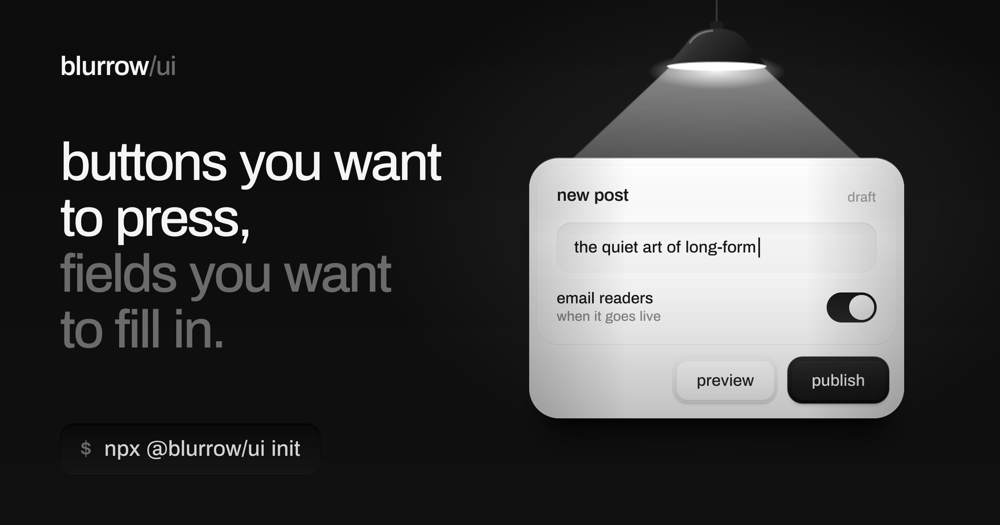
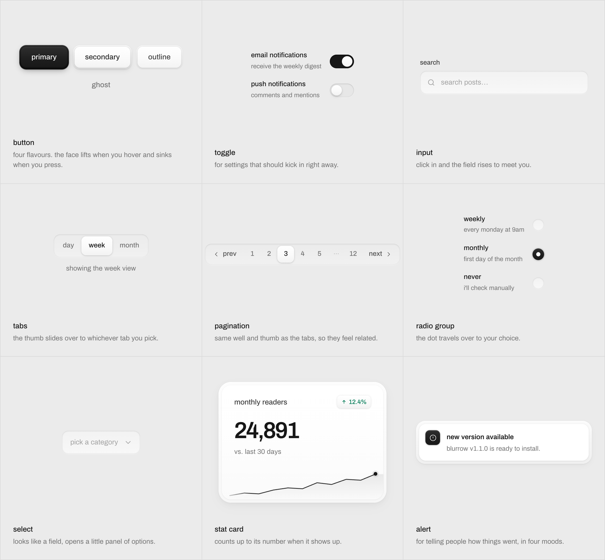
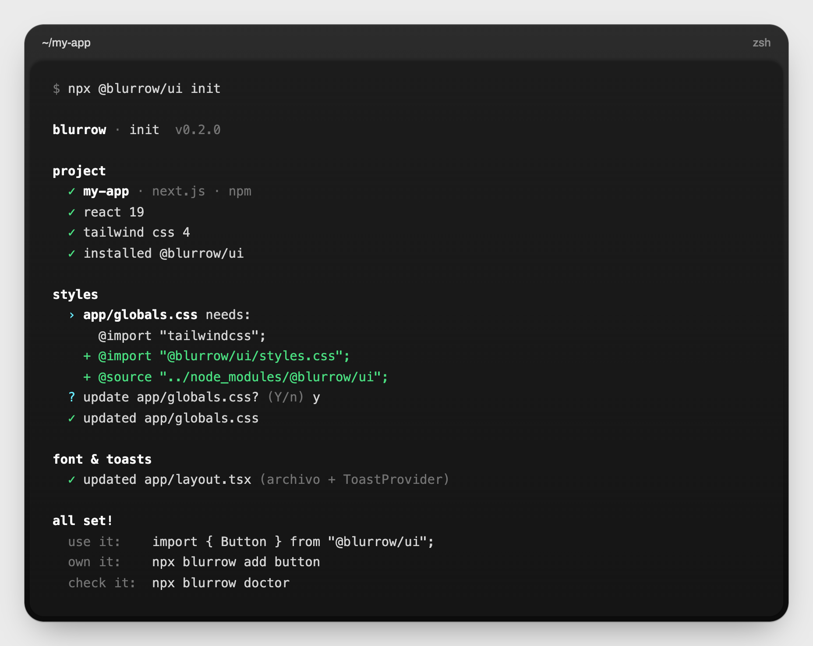
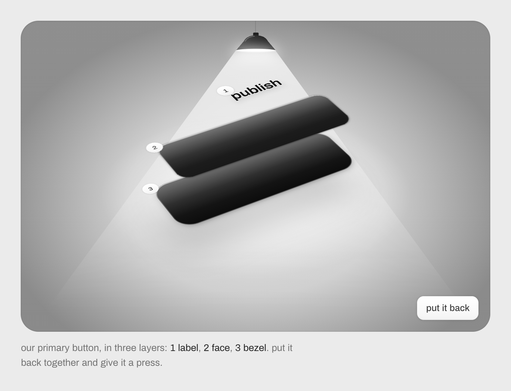
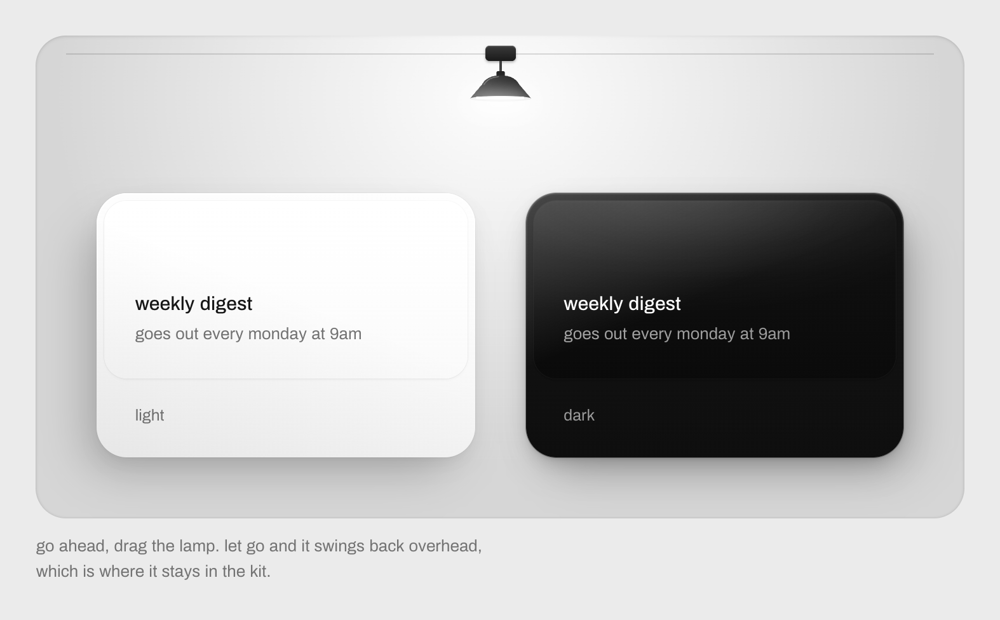
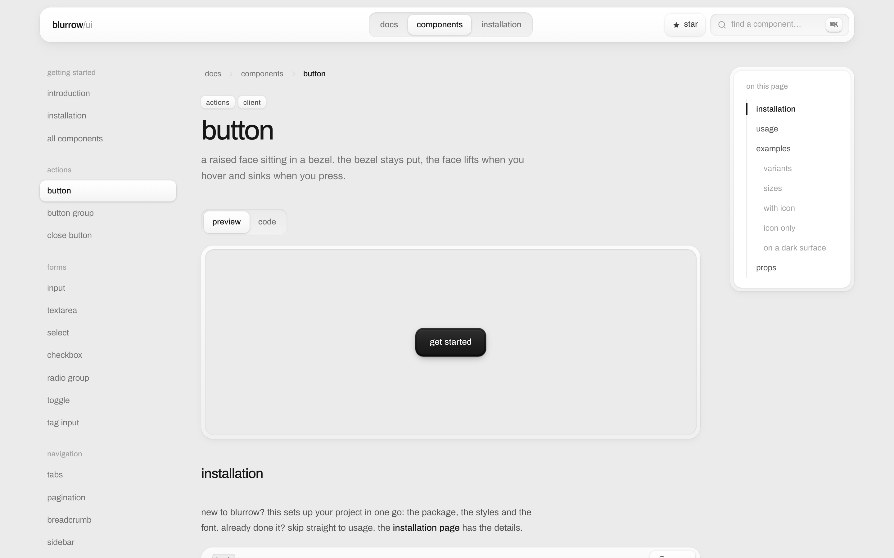
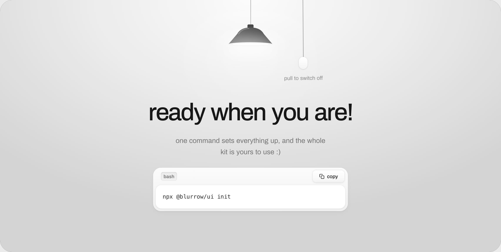

<a href="https://www.blurrow.org">
  
</a>

<p align="center">
  <a href="https://www.npmjs.com/package/@blurrow/ui"></a>
  <a href="https://www.npmjs.com/package/@blurrow/ui"></a>
  <a href="https://github.com/manyports/blurrow/stargazers"></a>
  <a href="LICENSE"></a>
</p>

<p align="center">
  <a href="https://www.blurrow.org"><b>website</b></a> &nbsp;·&nbsp;
  <a href="https://www.blurrow.org/docs">docs</a> &nbsp;·&nbsp;
  <a href="https://www.blurrow.org/docs/components">components</a> &nbsp;·&nbsp;
  <a href="https://www.npmjs.com/package/@blurrow/ui?activeTab=readme">npm</a>
</p>

<br>

blurrow is a set of 48 react components that look and feel like physical things. buttons sit in a bezel and sink when you press them. text fields are cut into the surface. every shadow agrees on where the light is coming from, so a page built from these parts holds together without you having to think about it.

i made it for my blog, [blogs](https://github.com/manyports/blogs), and kept polishing it until it felt wrong to keep it to myself. it's free, mit licensed, and built for react 19 and tailwind css v4.

<p align="center">
  
</p>

## getting started

```bash
npx @blurrow/ui init
```

that's the whole setup. it installs the package, adds two lines to your stylesheet, loads the archivo font and wraps your app in `ToastProvider`. it shows you each change before it writes anything, and running it a second time won't hurt.

<p align="center">
  
</p>

then use whatever you like:

```tsx
import { Button, Input, Toggle } from "@blurrow/ui";

export default function Settings() {
  return (
    <form className="flex flex-col gap-4">
      <Input label="display name" placeholder="ada" />
      <Toggle label="email me when someone replies" defaultChecked />
      <Button variant="primary">save</Button>
    </form>
  );
}
```

they drop straight into server components. the interactive ones are marked `"use client"`, and the static ones (badges, cards, avatars, skeletons…) render on the server and send no javascript. if you'd rather wire things up by hand, the [installation guide](https://www.blurrow.org/docs/installation) walks through the four steps `init` does for you.

## or keep the source

some people like a dependency. others like the code sitting in their own repo where they can bend it. both are fine.

```bash
npx @blurrow/ui add button tabs toast   # copies them in, plus anything they lean on
npx @blurrow/ui diff                    # shows what you've changed since
```

`add` never touches a file you've edited unless you pass `--overwrite`. run it with no names and you get a little picker: type to filter, space to choose.

| command | what it does |
| --- | --- |
| `init` | sets up a project: package, styles, font, toasts. safe to run again |
| `add [names…]` | copies components into your project, with their dependencies |
| `list` | every component, and which ones you've already copied |
| `diff [name]` | what you've changed in your copies compared to the release |
| `doctor [--fix]` | checks the setup and tells you how to fix anything that's off |

everything takes `--yes`, `--dry-run` and `--cwd <path>`. once the package is installed, `npx blurrow` works as a shorter name.

## one light source



every control is built from two parts: a bezel that never moves and a face that does. hover and the face lifts a pixel. press and it sinks flush with the bezel. that one idea repeats everywhere, from the smallest checkbox up to the cards.

things you press are raised. things you type into are sunken. you can tell a button from a field before you've read either of them.



and every shadow is drawn as if one lamp is hanging right above your screen. top edges catch the light, bottom edges fall into shade. since the lamp never moves, a light card and a dark card cast the same shadow and get along fine on the same page. on [the website](https://www.blurrow.org) you can grab that lamp and drag it around.

## what's in the box

| | |
| --- | --- |
| **actions** | [button](https://www.blurrow.org/docs/components/button) · [button group](https://www.blurrow.org/docs/components/button-group) · [close button](https://www.blurrow.org/docs/components/close-button) |
| **forms** | [input](https://www.blurrow.org/docs/components/input) · [textarea](https://www.blurrow.org/docs/components/textarea) · [select](https://www.blurrow.org/docs/components/select) · [checkbox](https://www.blurrow.org/docs/components/checkbox) · [radio group](https://www.blurrow.org/docs/components/radio-group) · [toggle](https://www.blurrow.org/docs/components/toggle) · [tag input](https://www.blurrow.org/docs/components/tag-input) |
| **navigation** | [tabs](https://www.blurrow.org/docs/components/tabs) · [pagination](https://www.blurrow.org/docs/components/pagination) · [breadcrumb](https://www.blurrow.org/docs/components/breadcrumb) · [sidebar](https://www.blurrow.org/docs/components/sidebar) · [steps](https://www.blurrow.org/docs/components/steps) · [table of contents](https://www.blurrow.org/docs/components/table-of-contents) · [command palette](https://www.blurrow.org/docs/components/command-palette) |
| **overlays** | [modal](https://www.blurrow.org/docs/components/modal) · [drawer](https://www.blurrow.org/docs/components/drawer) · [popover](https://www.blurrow.org/docs/components/popover) · [tooltip](https://www.blurrow.org/docs/components/tooltip) · [dropdown menu](https://www.blurrow.org/docs/components/dropdown-menu) · [toast](https://www.blurrow.org/docs/components/toast) |
| **feedback** | [alert](https://www.blurrow.org/docs/components/alert) · [banner](https://www.blurrow.org/docs/components/banner) · [progress](https://www.blurrow.org/docs/components/progress) · [skeleton](https://www.blurrow.org/docs/components/skeleton) · [empty state](https://www.blurrow.org/docs/components/empty-state) |
| **data display** | [badge](https://www.blurrow.org/docs/components/badge) · [avatar](https://www.blurrow.org/docs/components/avatar) · [kbd](https://www.blurrow.org/docs/components/kbd) · [table](https://www.blurrow.org/docs/components/table) · [data list](https://www.blurrow.org/docs/components/data-list) · [stat](https://www.blurrow.org/docs/components/stat) · [stat card](https://www.blurrow.org/docs/components/stat-card) · [timeline](https://www.blurrow.org/docs/components/timeline) · [code block](https://www.blurrow.org/docs/components/code-block) · [accordion](https://www.blurrow.org/docs/components/accordion) |
| **cards** | [card shell](https://www.blurrow.org/docs/components/card-shell) · [card](https://www.blurrow.org/docs/components/card) · [quote card](https://www.blurrow.org/docs/components/quote-card) · [spotlight card](https://www.blurrow.org/docs/components/spotlight-card) · [author card](https://www.blurrow.org/docs/components/author-card) · [carousel](https://www.blurrow.org/docs/components/carousel) |
| **editorial** | [reading progress](https://www.blurrow.org/docs/components/reading-progress) · [reading time](https://www.blurrow.org/docs/components/reading-time) · [reaction bar](https://www.blurrow.org/docs/components/reaction-bar) · [share buttons](https://www.blurrow.org/docs/components/share-buttons) |

each one has [its own page](https://www.blurrow.org/docs/components) with a live preview, a handful of examples, its props and the full source.



## working on blurrow

issues and pull requests are very welcome, whether it's a bug, a component you wish existed, or a shadow that's one pixel off.

```bash
git clone https://github.com/manyports/blurrow
cd blurrow
npm install
npm run dev        # the docs site, at http://localhost:3000
```

the repo is the docs site and the package at once, so the two can't drift apart.

| where | what lives there |
| --- | --- |
| `components/ui/` | the components themselves. this is what ships |
| `components/ui/styles.css` | the design tokens: materials, shadows, keyframes |
| `lib/registry.ts` | the catalogue the docs and the cli are built from |
| `examples/` | one file per example. the docs show each file's source |
| `app/` | the website |
| `packages/ui/` | the npm package and its cli |

**adding a component.** drop it in `components/ui/` and export it from `components/ui/index.ts`. write a couple of examples in `examples/`, register them in `examples/index.ts`, and add an entry to `lib/registry.ts`. the docs page, the install instructions and the props table all come from the source.

**releasing.** bump the version in `packages/ui/package.json`, then run `npm run package:publish`. it builds the bundle, the types, the stylesheet and the cli first.

## license

mit, so use it for anything. if you build something nice with it, i'd really like to see it.

<br>

<a href="https://www.blurrow.org">
  
</a>

<p align="center">
  made with care by <a href="https://manyports.com">@manyports</a>
</p>
